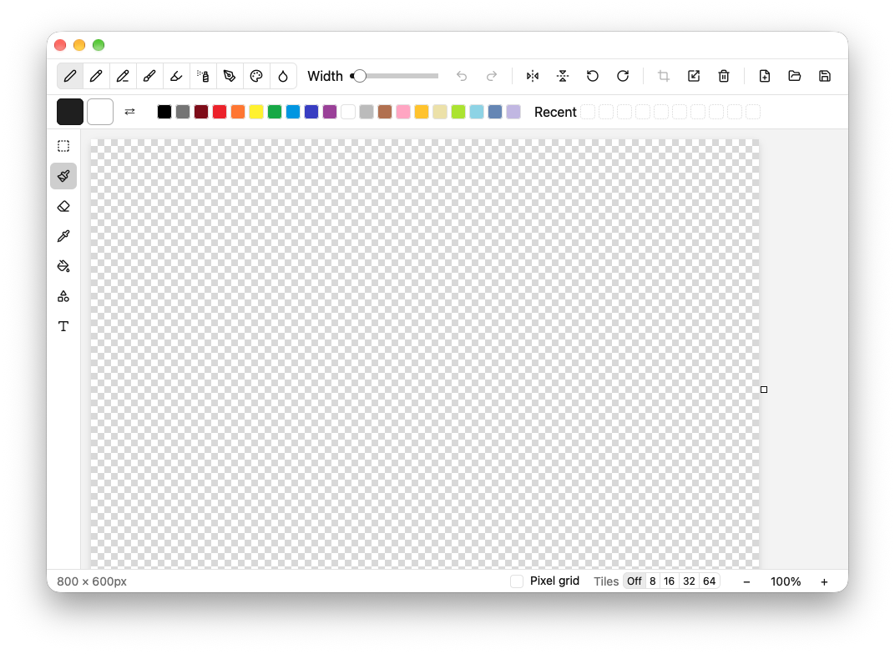

# petit-paint

A small paint app written in Rust with [GPUI](https://www.gpui.rs/).

It has only been tested on macOS.



## Features

- Tools: select, brush, eraser, eyedropper, fill, shape, text
- Undo and redo
- Copy, cut and paste selections
- Zoom
- Open and save PNG images

## Keyboard shortcuts

On Windows and Linux, use `Ctrl` in place of `Cmd`.

| Action | Shortcut |
| --- | --- |
| Undo | `Cmd+Z` |
| Redo | `Cmd+Shift+Z` (also `Ctrl+Y` on Windows and Linux) |
| Open | `Cmd+O` |
| Save | `Cmd+S` |
| Save as | `Cmd+Shift+S` |
| Close window | `Cmd+W` |
| Select all | `Cmd+A` |
| Copy / Cut / Paste | `Cmd+C` / `Cmd+X` / `Cmd+V` |
| Delete selection | `Delete` / `Backspace` |
| Deselect | `Esc` |
| Finish polygon | `Enter` |
| Zoom in / out | `Cmd+=` / `Cmd+-` |
| Reset zoom | `Cmd+0` |

## Run

```sh
cargo run
```

## License

MIT

Toolbar icons are from [Lucide](https://lucide.dev/), licensed under the ISC License.
